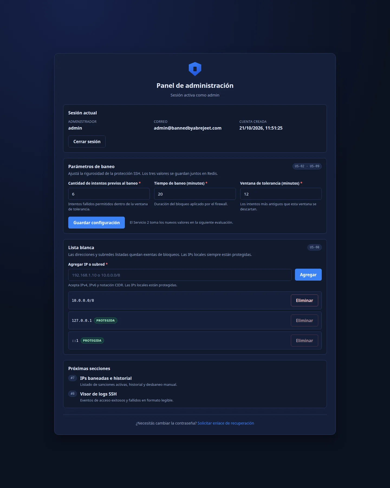
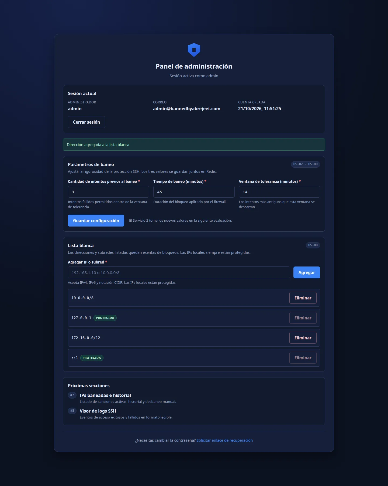

# Evidencias — Issue #6 (BACK1-02 / FRONT-02)

> Verificación realizada el 2026-10-21 sobre un Redis descartable (`127.0.0.1:6399`, db 15) y el Frontend A servido por Vite.

## Criterios de aceptación

| Criterio | Resultado |
|---|---|
| Configurar intentos previos al baneo y tiempo de baneo | ✅ Campos `maxretry` y `bantime` en el dashboard y `PUT /api/v1/config/settings` |
| Ventana de tolerancia (findtime) | ✅ Campo «Ventana de tolerancia (minutos)» persistido como `findtime` |
| Alta y baja de IPs/subredes | ✅ `POST` y `DELETE /api/v1/config/whitelist`, con normalización CIDR |
| `127.0.0.1` siempre incluida y no eliminable | ✅ Se reinserta en cada lectura; `DELETE` responde `409`; botón deshabilitado en la interfaz |
| Persistencia en Redis | ✅ Verificado con `HGETALL config:settings` y `SMEMBERS config:whitelist` |

## Vista inicial

Los valores mostrados provienen de Redis (`6`, `20`, `12`) y la whitelist incluye las dos IPs locales protegidas.



## Actualización desde el formulario

Se guardaron `9` intentos, `45` minutos de baneo y `14` minutos de ventana; además se agregó `172.16.0.0/12`.



## Persistencia comprobada en Redis

```text
$ docker exec bba-test-redis redis-cli -n 15 HGETALL config:settings
maxretry
9
bantime
45
findtime
14

$ docker exec bba-test-redis redis-cli -n 15 SMEMBERS config:whitelist
::1
10.0.0.0/8
127.0.0.1
172.16.0.0/12
```

La subred `10.1.2.3/8` enviada por la API se normalizó a `10.0.0.0/8`. El intento de eliminar `127.0.0.1` devolvió:

```json
{"detail":"La IP local no puede eliminarse de la lista blanca"}
```

## Pruebas automatizadas

```text
$ TEST_REDIS_URL="redis://127.0.0.1:6399/15" PYTHONPATH=.pylibs python -m pytest -q
85 passed
```

- `tests/test_config_api.py`: 37 casos de configuración, whitelist, validación y OpenAPI.
- `npm run lint` y `npm run build` del Frontend A finalizaron sin errores.
