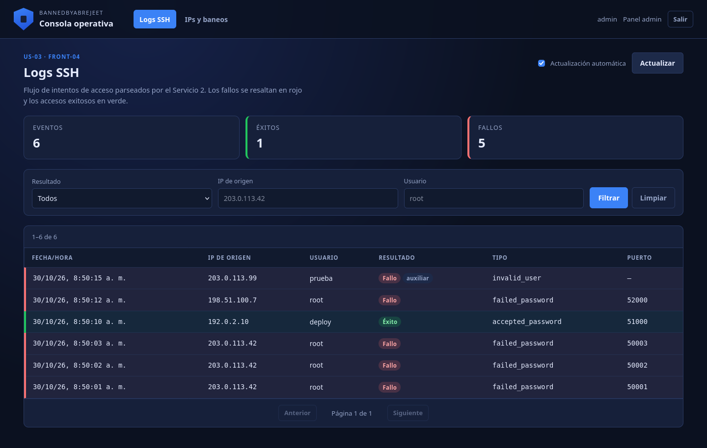
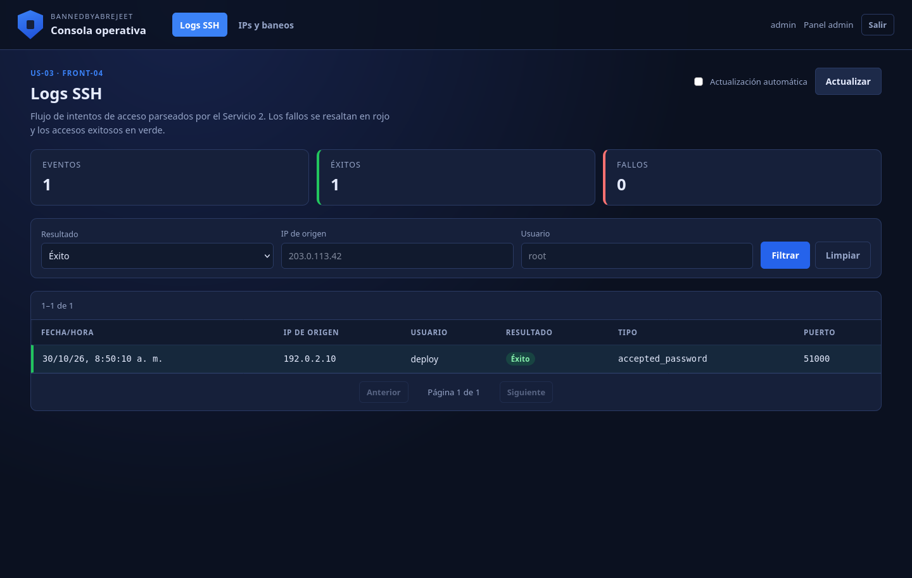
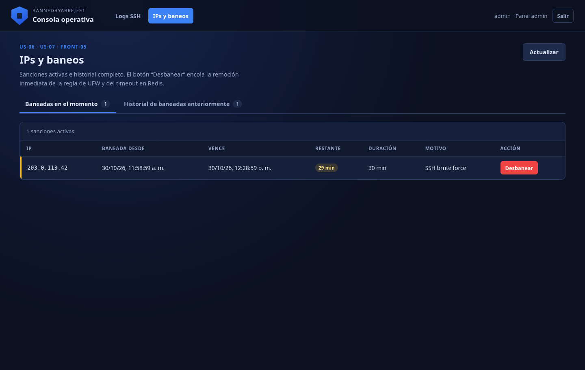
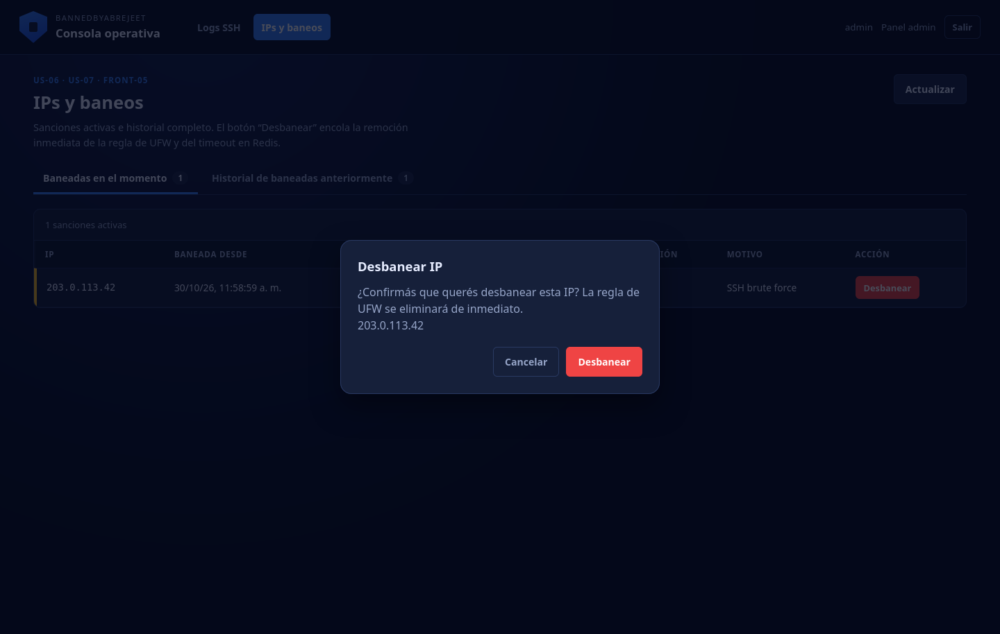
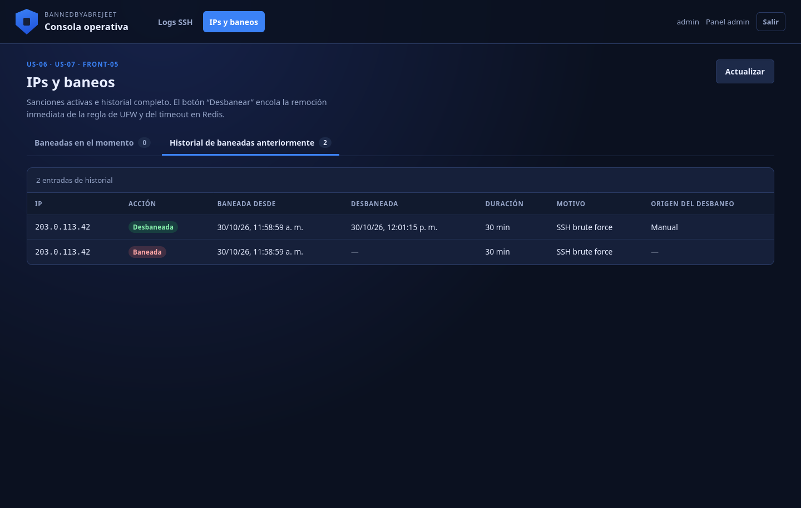

# Issue #9 — Visor de logs SSH y estado de IPs (Frontend B)

**Fecha:** 2026-10-30  
**Rama:** `11-issue-9-visor-formateado-de-logs-ssh-y-estado-de-ips-frontend-b`  
**Alcance entregado:** `FRONT-04` (visor de logs) y `FRONT-05` (desbaneo
manual), más los endpoints de telemetría del Servicio 2 que los alimentan.

## 1. Criterios de aceptación

| Criterio | Implementación | Evidencia |
|---|---|---|
| Mostrar Fecha/Hora, IP, usuario y resultado | Tabla de `LogsView.vue` con columnas dedicadas | `issue-09-logs.png` |
| Diferenciación visual entre éxito y fallo | Filas con borde/fondo verde o rojo y badges “Éxito” / “Fallo” | `issue-09-logs.png` |
| Clasificar IPs en “Baneadas en el momento” e “Historial de baneadas anteriormente” | Pestañas en `BansView.vue` con contadores | `issue-09-ips.png` |
| Botón “Desbanear” junto a cada IP activa | Acción por fila + diálogo de confirmación | `issue-09-unban.png` |
| La orden llega al Servicio 2 y elimina UFW + timeout | `DELETE /telemetry/bans/<ip>` publica en `security:events:unban`; el worker ejecuta el desbaneo | `issue-09-history.png` |
| Filtrado visual intuitivo | Filtros por resultado, IP y usuario; resumen de éxitos/fallos | `issue-09-logs-filtered.png` |

## 2. Capturas de la interfaz

### 2.1. Visor de logs SSH



La tabla muestra fecha/hora, IP de origen, usuario, resultado, tipo de evento y
puerto. Los fallos usan borde y badge rojo; los éxitos, verde. La línea
`Invalid user` se marca como auxiliar para no confundirla con un intento
canónico.

### 2.2. Filtrado por resultado



Los contadores superiores se recalculan según el filtro aplicado.

### 2.3. IPs baneadas en el momento



Cada sanción muestra IP, fecha de baneo, vencimiento, tiempo restante,
duración y motivo, con el botón **Desbanear**.

### 2.4. Confirmación de desbaneo



### 2.5. Historial después del desbaneo manual



La IP desaparece de las sanciones activas y se agrega al historial con
`unban_reason="manual"`.

## 3. Backend de telemetría agregado

La Issue #9 necesitaba endpoints que no existían todavía en el Servicio 2. Se
agregaron:

| Método | Ruta | Descripción |
|---|---|---|
| `GET` | `/telemetry/logs` | Eventos SSH paginados; filtros `outcome`, `ip`, `username`; contadores `total/success/failed`. |
| `GET` | `/telemetry/bans` | Sanciones activas leídas de `ips:banned`. |
| `GET` | `/telemetry/history` | Historial paginado de `ips:history`. |
| `DELETE` | `/telemetry/bans/<ip>` | Publica `UNBAN` en `security:events:unban`; responde `202`. |

- **Persistencia de logs:** `app/telemetry.py` guarda cada evento en la lista
  `ssh:events` con `LPUSH` + `LTRIM` (`SSH_EVENTS_LIMIT=2000`).
- **Autenticación:** `app/auth.py` valida firma, `iss`, `aud`, expiración y
  `session_version` contra `admin:credentials`. El Frontend B reutiliza el JWT
  del Frontend A.
- **Desbaneo:** la API no ejecuta UFW desde Flask; encola el evento y el
  worker del proceso motor (con privilegios) elimina la regla y el timeout.

## 4. Pruebas

Servicio 2:

```bash
cd backend-service2
PYTHONPATH=../backend-service1/.pylibs python -m pytest -q
```

Resultado real:

```text
93 passed in 0.54s
```

Incluye pruebas de:

- almacenamiento, orden, filtros y paginación de `ssh:events`;
- lectura de baneos e historial;
- autenticación JWT, token inválido y sesión revocada;
- endpoint de desbaneo publicando el evento del contrato;
- registro de eventos desde el monitor.

Frontend B:

```bash
cd frontend-ops
npm run lint
npm run build
```

Resultado:

```text
eslint: sin errores ni warnings
vite build: 84 modules transformed; build OK
```

Frontend A sigue pasando `npm run lint` y `npm run build`.

## 5. Cómo probarlo

1. Levantar Redis, Servicio 1, Flask del Servicio 2, motor y ambos frontends.
2. Entrar a `http://localhost:3000/login`, iniciar sesión y abrir
   **Consola operativa**.
3. Generar eventos SSH en el log apuntado por `SSH_LOG_PATH`.
4. Verificar el visor y los filtros en `/logs/`.
5. Ir a `/logs/bans`, comprobar las sanciones activas y usar **Desbanear**.

En desarrollo la consola se sirve bajo el mismo origen que el Frontend A
(`/logs/`) para compartir el token de `sessionStorage`; el
[`vite.config.js`](../../frontend-admin/vite.config.js) del Frontend A redirige
`/logs` a `3001` y `/telemetry` a `5000`.
